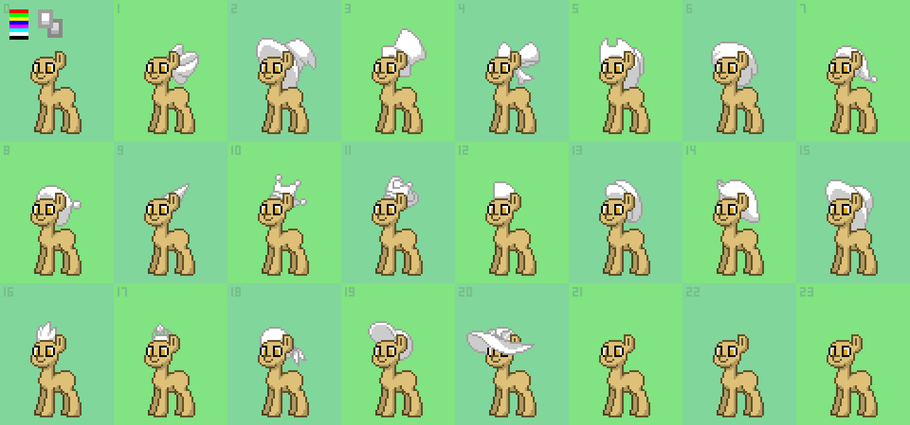
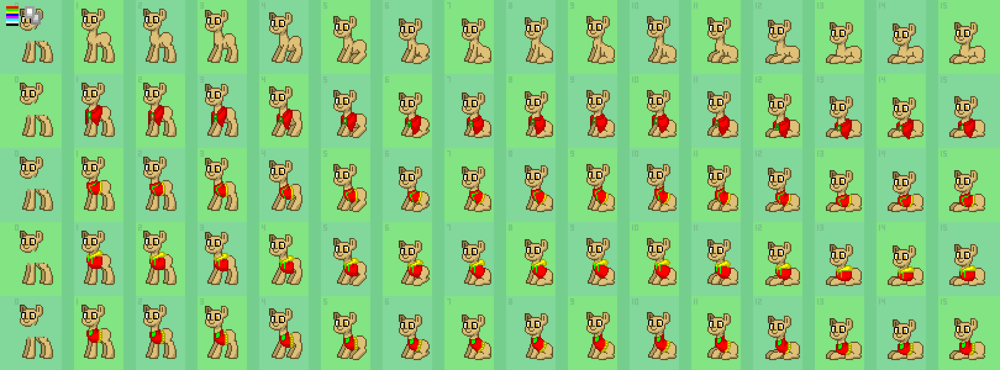
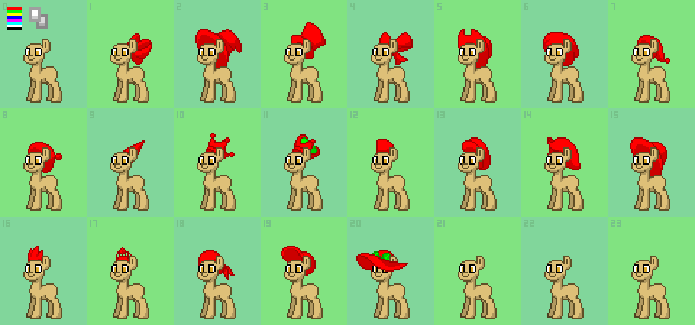

# Как нарисовать свой аксессуар для Leviathan Town

Гайд для тех, кто не программист. Ничего устанавливать не нужно: рисуем в браузере
в [Photopea](https://www.photopea.com/) (бесплатный онлайн-аналог Photoshop),
а сборку и загрузку в игру делает Claude.

---

## 0. Как это устроено

Персонаж в игре собирается из слоёв, как бумажная кукла: тело, ноги, грива, шляпа,
шарф и так далее. Каждое место, куда можно надеть вещь, называется **слотом**.

Все рисунки слотов лежат в папке `assets-source/pony/` репозитория в файлах **PSD**.
PSD — это формат Photoshop: картинка, разложенная на слои, которые можно включать и
выключать. Один PSD — это один слот со *всеми* вещами для него: каждая вещь занимает
свою клетку или строку.

Когда PSD изменился, запускается **сборка спрайтов**. Это программа
(`src/ts/tools/create-sprites.ts`), которая режет PSD на маленькие картинки
(спрайты), склеивает их в один большой лист `assets/images/pony2.png` и записывает,
где что лежит, в `src/ts/generated/sprites.ts`. Игра потом рисует пони из этого листа.
Новая вещь появится в редакторе персонажа сама, отдельно прописывать её в коде не нужно
(одно исключение есть у шляп, см. раздел 7).

Новая вещь никак не называется: в редакторе у неё просто следующий номер.

## 1. Какие есть слоты

| Слот в редакторе | Файл | Как рисуется |
|---|---|---|
| Шляпа / на голову | `head-accessory.psd` | 1 картинка на вещь |
| На уши | `ear-accessory.psd` | 1 картинка на вещь |
| На лицо (очки, маски) | `face-accessory.psd` | 1 картинка на вещь |
| На шею | `neck-accessory.psd` | 16 кадров на вещь |
| На грудь (жилеты, кофты) | `body-chest-accessory.psd` | 16 кадров на вещь |
| На пояс | `body-waist-accessory.psd` | 17 кадров на вещь |
| На спину | `body-back-accessory.psd` | 16 кадров на вещь |
| Рукава передних ног | `front-legs-sleeves.psd` | 39 кадров на вещь |
| Рукава/штанины задних ног | `back-legs-sleeves.psd` | 27 кадров на вещь |

**Начни со шляпы.** Шляпа рисуется один раз, а игра сама двигает её вместе с
головой во всех позах. В файле шляп уже есть свободные клетки, поэтому это самый
быстрый способ увидеть свою вещь в игре. Вещи для тела и ног нужно рисовать
в каждом кадре анимации: пони стоит, садится, ложится, ноги шагают.

Ограничение игры: в одном слоте не больше 31 вещи (номера 0–31, номер 0 означает
«ничего»). В шляпах сейчас занято 20.

Слот «extra accessory» не трогай: в собранной игре из него показываются только
первые две вещи.

## 2. Скачай шаблон

1. Открой файл слота на GitHub, например
   [head-accessory.psd](https://github.com/tratratraktor-arch/leviathan-town/blob/main/assets-source/pony/head-accessory.psd).
2. Нажми кнопку **Download raw file** (стрелка вниз справа сверху).
3. Зайди на [photopea.com](https://www.photopea.com/), **File → Open** и выбери скачанный файл.

## 3. Что внутри шаблона

Справа в Photopea панель **Layers** (слои). Типичный набор:

- `<bg>` — зелёный фон в клеточку и серые номера клеток. Не рисуй на нём.
- `<body>`, `<far ear>`, `<front legs>` и всё в `<угловых скобках>` — бежевая
  пони-образец. Она нужна, только чтобы видеть, куда рисовать. Сборка эти слои
  игнорирует.
- Папки **`front`** и **`behind`** — сама вещь. `front` рисуется *перед* пони,
  `behind` *за* ней. У шляпы, например, задний край полей уходит в `behind`, чтобы
  его закрывала голова. Если вещь целиком спереди, `behind` оставь пустым.
- Внутри каждой папки:
  - **`color`** — рисунок вещи в оттенках серого (раздел 4);
  - **`pattern 0`, `pattern 1`, …** — карты цветов (раздел 5).
- `<refs>` — подсказка в левом верхнем углу: полоски цветов для карт и квадратики
  с правильными оттенками серого.

**Не переименовывай и не удаляй слои.** Сборка ищет их по именам: `color`,
`pattern 0`, `front`, `behind`. Если имя изменится, вещь не найдётся.

### Клетки шляп (одна картинка на вещь)

Клетка 0 пустая, это «без шляпы». Клетки 1–20 заняты, 21–23 свободны.
Новую шляпу рисуй в клетке **21**.

### Строки для тела (16 кадров на вещь)

Каждая **строка** — одна вещь, каждый **столбец** — кадр анимации. Пони в кадрах
1–15 стоит, садится и ложится, и вещь должна повторять это движение. Самая верхняя
строка пустая, это «ничего». Столбец 0 у всех вещей оставлен пустым, оставляй
его пустым и ты.

В файлах для тела и ног свободных строк обычно нет. Напиши Claude, например:
«подготовь шаблон груди с 2 пустыми строками», и он пришлёт PSD с местом под
новые вещи и пони-образцом в каждом кадре.

## 4. Рисуем вещь: слой `color`

Вещь рисуется **только серыми**, а цвет игрок выберет потом в редакторе. Серые
оттенки означают объём и обводку. Сборка понимает ровно шесть оттенков:

| Что это | Цвет |
|---|---|
| Заливка (основной цвет) | `#ffffff` |
| Заливка потемнее | `#d9d9d9` |
| Тень | `#cccccc` |
| Глубокая тень | `#aeaeae` |
| Обводка | `#9f9f9f` |
| Тёмная обводка | `#878787` |

Обводка и тёмная обводка в игре окрасятся в цвет обводки, остальное в цвет заливки
с нужной тенью. Самый простой вариант: белая заливка с обводкой `#9f9f9f`, тени
добавишь, когда освоишься.

Правила, без которых сборка выдаст ошибку:

1. **Рисуй инструментом Pencil (карандаш), не Brush (кисть).** Кисть делает мягкие
   полупрозрачные края, а каждый пиксель должен быть либо полностью закрашен, либо
   пустым. Карандаш в Photopea спрятан под кистью: зажми на её иконке.
2. Размер карандаша 1 px, непрозрачность (Opacity) 100%.
3. Не используй других серых и вообще цветных пикселей в `color`.
4. Рисуй в слое `color` нужной папки: выбери его кликом в панели слоёв.
5. Посмотри на соседние вещи, чтобы попасть в масштаб: у пони голова примерно
   20 пикселей.

Удобно приблизить картинку до 800–1600% (колёсико мыши с Alt) и включить сетку
пикселей: **View → Show → Pixel Grid**.

## 5. Зоны цвета: слои `pattern`

Слой `pattern 0` говорит игре, какие части вещи красятся каким цветом. Например,
у шляпы тулья одного цвета, а лента другого. Каждая зона закрашивается своим
**чистым** цветом:

| Цвет в pattern | Цвет в редакторе |
|---|---|
| Красный `#ff0000` | Цвет 1 |
| Зелёный `#00ff00` | Цвет 2 |
| Жёлтый `#ffff00` | Цвет 3 |
| Синий `#0000ff` | Цвет 4 |
| Фиолетовый `#ff00ff` | Цвет 5 |
| Бирюзовый `#00ffff` | Цвет 6 |
| Белый `#ffffff` | Цвет 7 |
| Чёрный `#000000` | Цвет 8 |

Хватает обычно одного–трёх цветов. Если вещь одноцветная, просто залей её в
`pattern 0` красным.

Как это сделать:

1. Слои `pattern` по умолчанию скрыты. Нажми на «глаз» слева от `pattern 0`,
   чтобы его включить.
2. Слой «приклеен» к `color` и наложен в режиме умножения. Поэтому видно только
   то, что попало на вещь, и сразу видно, как раскраска ляжет на серый рисунок.
3. Закрась вещь карандашом нужными цветами. Красить можно с запасом: всё, что
   вышло за пределы вещи, сборка сама обрежет. Но внутри вещи не оставляй дыр:
   каждый пиксель вещи должен получить цвет.

**`pattern 1`, `pattern 2` и дальше — это варианты одной вещи** с другой
раскраской: например, `pattern 0` однотонный, а `pattern 1` с полосками. В редакторе
они переключаются как узоры (pattern) этой вещи. Для начала достаточно `pattern 0`.

## 6. Сохрани и отправь

1. Сохрани: **File → Save as PSD**. Имя файла оставь прежним (`head-accessory.psd`).
2. Пришли файл Claude в чат и напиши, что нарисовал и в какой клетке/строке:
   «новая шляпа в клетке 21».

Дальше Claude:

1. кладёт файл на место в `assets-source/pony/`;
2. запускает сборку спрайтов и, если она ругается, говорит, какой пиксель
   неправильный (сборка называет координаты);
3. открывает pull request — предложение изменений в репозитории, которое ты
   принимаешь кнопкой **Merge** на GitHub.

После Merge GitHub сам соберёт новую версию игры, а сервер получит её при следующем
обновлении (той же командой `deploy.sh`, которой игру ставили).

## 7. Проверь в игре

1. Зайди в игру и открой редактор персонажа.
2. Выбери нужный слот (например, Head accessory) и пролистай до последнего номера.
   Новая вещь будет там.
3. Поменяй ей цвета, проверь все узоры, если их несколько.
4. Для вещей на тело или ноги походи, сядь и ляг: так видно все кадры.

Особенность шляп: в коде временно спрятана последняя шляпа (летняя, в клетке 20),
строки с пометкой `TEMP: remove summer hat` в `src/ts/client/ponyUtils.ts`. Код
прячет просто последнюю шляпу, поэтому с новой шляпой спряталась бы она, а не
летняя. Claude уберёт эти две строки в том же pull request, когда добавит первую
шляпу. Летняя шляпа тогда тоже станет доступна.

## Частые ошибки

| Ошибка сборки | Что значит | Как исправить |
|---|---|---|
| `Invalid color [...] (x y)` | В `color` полупрозрачный пиксель | Перерисуй это место карандашом, Opacity 100% |
| `Invalid color (pattern)` | В `pattern` нечистый цвет | Перекрась точными цветами из таблицы раздела 5 |
| Вещь не появилась | Нарисовано не в том слое или слой переименован | Проверь, что рисунок в `front/color` или `behind/color` |
| Вещь не появилась, хотя рисунок на месте | Пустой `pattern 0`: без карты цветов сборка вещь пропускает | Залей вещь красным в `pattern 0` |
| Вещь «прыгает» в анимации | Кадры нарисованы в разных местах относительно пони | Сверь каждый кадр с пони-образцом |

## Про права

Всё, что ты нарисуешь сам, принадлежит тебе. Старая графика Pony Town в этом
репозитории идёт под лицензией CC BY-NC (`LICENSE_ART.txt`): можно менять и
использовать, но только некоммерчески и с указанием авторов. Перерисовывать вещи
из нынешнего Pony Town пиксель в пиксель не стоит: эта графика не открыта.
